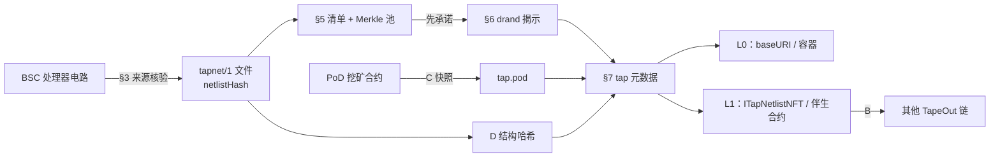
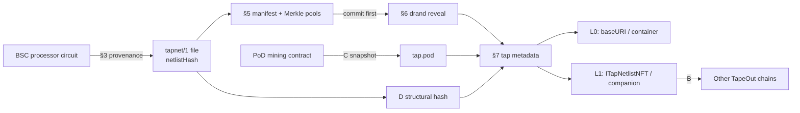

# TAP-721 · Netlist-Bound NFT

**One flagship TapeOut standard with in-document extensions, plus three extension TAPs — organised like ERC-721. NFTs that carry a verifiable, runnable on-chain circuit.**

[中文](#中文) · [English](#english)

> **状态 / Status:** Draft · TAP 编号未分配 / TAP numbers not assigned · 未部署 / not deployed · 仅内部审计 / audited internally only

---

## 中文

### 定义

**TAP-721**（正式标题 *Netlist-Bound NFTs*，草案见 [`TAPs/TAP-draft-netlist-bound-nft.md`](TAPs/TAP-draft-netlist-bound-nft.md)；TAP-721 是社区昵称，正式编号由 TAPs 编辑分配）扩展 ERC-721，让每枚 token 在图片之外绑定一份真实的 TapeOut 电路：一个自包含的 `tapnet/1` 网表文件（TAP-02 的 NAND/LATCH 记录加 16 字节文件头，其 SHA-256 即网表哈希）。任何人都能下载它、对照来源链核验、仿真、在合约里运行，并在任一 TapeOut 链上重新流片。标准还规定了 CAIP-19 全局标识、元数据中的 `tap` 对象、先承诺后随机的公平揭示（Merkle 承诺的清单 + drand 种子 + 带密钥置换），以及 L0/L1 两个一致性等级。标准不涉及任何收益：NFT 提供的是绑定、公平分配与来源证明。

### 一致性摘要

| 部分 | 状态 | 章节 | 接口（ERC-165 ID） |
|---|---|---|---|
| `tapnet/1` 文件、网表哈希 | 核心 | §2 | — |
| 来源电路 | 可选声明；声明即须可核验 | §3 | — |
| Token 标识、内容地址 | 核心 | §4 | — |
| 清单、池、Merkle 树 | 揭示或实现 L1 的集合为核心 | §5.1–§5.3 | — |
| Token 集合（代币集模式） | 条件：token 编号不连续时 | §5.4 | — |
| 揭示（主种子、池种子、置换、版次） | 有清单的集合为核心 | §6 | — |
| `tap` 元数据 | 核心（L0 与 L1） | §7 | — |
| **L0** | 一致性等级：仅元数据 | §8.1 | — |
| **L1** | 一致性等级：链上接口 | §8.2 | `ITapNetlistNFT` `0x282b67f6`、ERC-165 `0x01ffc9a7`、ERC-4906 `0x49064906` |
| TAP-721 伴生合约扩展 | 条件：为现有 ERC-721 实现 L1 | §8.3 | `ITapCompanion` `0x12b40a6c` |
| TAP-721 求值扩展 | 可选 | §8.4 | `ITapNetlistEval` `0xec7d7e20` |
| TAP-721 TokenSet 扩展 | 条件：代币集模式的 L1 合约（区间模式可选） | §8.5 | `ITapNetlistTokenSet` `0x3f7177c7` |
| TAP-721 容器托管与锁定 | 建议：内容放在 TapeOut 容器时 | §8.6、§7.5 | — |

实现者清单见 [docs/STANDARD.md](docs/STANDARD.md)。

### C/N/L 在标准中的位置

社区把 TapeOut 的三个原生构件简称 C/N/L：**电容**（社区对 TapeOut 容器的昵称）、**NAND**、**LATCH**。

| 构件 | 在标准里 |
|---|---|
| **C 电容（容器）** | 内容托管（`tape://` 地址、`tap.content`，§4.2、§7.5）与锁定（`TapContainerLock`）；来源电路的容器用 `accountOf` 核验（§3.2）；老集合的 owner 可以是一个容器；服务器端网关从容器读取并校验文件 |
| **N NAND** | `tapnet/1` 两种记录之一（7 字节）；`nand` 是每枚 token 的网表指标；组合电路只由 NAND 构成 |
| **L LATCH** | 另一种记录（4 字节），承载状态；`latch` 等于状态位数，决定用 `evalOf`（无 LATCH）还是 `stepOf` |

### TAP-721 家族

TAP-721 是一个标准，不是四份并列的草案：一份**主标准**（核心 + 文档内的可选扩展），加三个建立在它之上的**扩展 TAP**——就像 ERC-721 自带元数据、枚举扩展，而 ERC-4906、ERC-7496 是独立的 ERC。英文为规范文本，`.zh.md` 为中文译本。

| 组成 | 文档 | 类型 | 内容 | 地位 |
|---|---|---|---|---|
| **主标准 TAP-721** | [Netlist-Bound NFTs](TAPs/TAP-draft-netlist-bound-nft.md)（[中文](TAPs/TAP-draft-netlist-bound-nft.zh.md)） | Standards | 核心 §1–§8.2（上表），申请编号 721 | 必需 |
| 伴生合约 / 求值 / TokenSet / 容器托管 | 主标准 §8.3–§8.6 | — | 文档内扩展 | 可选或条件必需 |
| **扩展 B 跨链移动** | [Bridging](TAPs/TAP-draft-netlist-nft-bridging.md)（[中文](TAPs/TAP-draft-netlist-nft-bridging.zh.md)） | Standards | Gateway / Mirror、载荷、ONE/ALL 路由、LayerZero V2 与 TAP-10 hub 适配器 | 可选；首个集合 v1 不部署 |
| **扩展 C PoD 属性** | [PoD Attributes](TAPs/TAP-draft-pod-attributes.md)（[中文](TAPs/TAP-draft-pod-attributes.zh.md)） | Application | 固定区块的挖矿事实快照写入 `tap.pod` 与 ERC-7496 特征，含功能正确性检查 | 可选 |
| **扩展 D 结构哈希** | [Structural Hash](TAPs/TAP-draft-netlist-structural-hash.md)（[中文](TAPs/TAP-draft-netlist-structural-hash.zh.md)） | Standards | 对改编号、换输入、死门、复制门不变的哈希，揭穿伪稀缺 | 可选 |

**为什么不是四合一。** 放进主标准的，是每个实现者都要一起读、直接用到核心哈希、清单和接口的部分。独立成扩展 TAP 的，各有外部依赖或独立受众：跨链依赖消息层和可升级合约，而按 TAP-01 §5.1，依赖可升级合约的 TAP 只能停在 Candidate 直到该合约封存；PoD 属性依赖 BSC 挖矿合约；结构哈希只依赖 TAP-02、对任何网表都有用。合成一份，主标准会被这些依赖拖住，而首个采用者只需要主标准；TAPs 编辑也按"一份 TAP 一个主题"审核。

**提交计划。** ① 在 TapeOutProtocol/TAPs 开一个 Idea issue 讨论整个家族，申请主标准编号 721（接受编辑另行分配）；② 先为主标准提交 PR，`discussions-to` 指向该 issue；③ 三个扩展 TAP 随后各自提交 PR。草稿见 [`docs/submission/`](docs/submission/)。



### 快速验证一枚 token

1. 取 `tokenURI` 的 JSON，读 `tap`（标识、状态、清单、图片、网表）。
2. 从 `tap.netlist.uris` 任一地址取网表，核对 SHA-256、文件有效性与指标（`python3 assets/tap-netlist-bound-nft/tapnft.py token.json file.tapnet` 逐个检查文件）。
3. 取清单（代币集模式下还有 token 集合文件），核对哈希，用 drand 轮次复算该 token 分到的条目：`python3 tools/collection/verify_collection.py --manifest … --base-url …/ --beacon beacon.json`。
4. 若声明了来源，读来源链的 `circuitInfo` / `netlist` 重建文件并比对哈希。
5. L1：直接读合约的 `netlistHashOf`、`imageHashOf`、`frozen()`；L0 必须标注"仅元数据"。

### 快速开始

需要 Python 3.11、[Foundry](https://getfoundry.sh) v1.8.3、Node 20+。

```bash
git clone --recurse-submodules <repo-url> && cd TAP-721
pip install pycryptodome
(cd assets/tap-netlist-bound-nft       && python3 make_vectors.py && python3 test_tapnft.py)
(cd assets/tap-netlist-structural-hash && python3 make_vectors.py && python3 test_canon.py)
(cd assets/tap-pod-attributes          && python3 make_vectors.py && python3 test_pod.py)
(cd assets/tap-netlist-nft-bridging    && python3 make_vectors.py --check)
(cd contracts && forge build && forge test)
(cd contracts && XLAYER_RPC=https://rpc.xlayer.tech forge test --evm-version cancun --match-path test/fork/ContainerLock.t.sol)
(cd tools/gateway && npm test)
```

当前结果与向量哈希见 [docs/TESTING.md](docs/TESTING.md)（forge 198/198）。

### 仓库结构

| 路径 | 内容 |
|---|---|
| `TAPs/` | 主标准与三个扩展 TAP（英文 + 中文译本） |
| `assets/tap-*/` | 各草案的 Python 参考实现、生成器、测试与 `vectors.json`；`assets/chain-snapshot.json` 为 BSC 只读快照 |
| `contracts/` | Foundry 工程：`src/core`（L1 集合、伴生合约、求值器）、`src/bridge`、`src/interfaces`、`src/tools`（容器锁）；测试含审查 PoC |
| `tools/collection/` | 集合流水线：建池、清单、drand 揭示、校验、功能检查、稀有度规则 |
| `tools/tokenset/` | 在固定区块扫描 TapeCode-Test1 持有人，生成 token 集合 |
| `tools/uploader/`、`tools/gateway/` | 容器上传工具；服务器端 TAP-10 网关 |
| `profiles/` | TapeCode-Test1 配额工具 `tct1_quota.py` |
| `reviews/` | 编辑、安全、架构、跨链与定稿复审 |
| `docs/` | [STANDARD](docs/STANDARD.md)、[submission](docs/submission/)（提交草稿）、[ARCHITECTURE](docs/ARCHITECTURE.md)、[FACTS](docs/FACTS.md)、[TESTING](docs/TESTING.md)、[SECURITY](docs/SECURITY.md)、[DESIGN](docs/DESIGN.md)；`docs/article/` 为中文介绍文章 |
| `scripts/sync-from-drafts.sh` | 维护者用：从工作目录同步可发布文件 |

### 状态

**Draft**。TAP 编号未分配（`tap: TBD`）；合约**未部署**；**仅内部审计**（`reviews/security-contracts.md`，四轮：首轮 0 严重 / 0 高 / 3 中 / 9 低，中低危已修复或接受，后续各轮发现已在代码中处理，最新一处修复尚未复审）。一份公平性与经济性评审在向 TapeOut 团队披露前暂不公开（见 [docs/SECURITY.md](docs/SECURITY.md)）。版本记录见 [CHANGELOG.md](CHANGELOG.md)。

### 首个采用者：TapeCode-Test1

X Layer 上已领完的 10,000 枚集合 TapeCode-Test1（`0x0e91…1614`）是第一个采用者。合约只能修改 base URI，没有 ERC-4906，所以走"L0 + 伴生合约"路线：每枚 token 一张头像（图片池）和一份真实 PoD 矿机网表（网表池），清单在 drand 轮次之前承诺；伴生合约整池载入并提供 `ITapNetlistEval`，让 X Layer 上的合约运行这些电路；内容放进上传后锁定的容器。有 3,000 枚在永远无法转出的地址中（`balanceOf(0x…dEaD)` = 3,000），因此用代币集模式覆盖其余 7,000 枚。具体方案仍在与创始人确认。

### 参与

按 TAP-01：在 [TapeOutProtocol/TAPs](https://github.com/TapeOutProtocol/TAPs) 开 Idea issue → 草案 `discussions-to` 指向该 issue → 每份草案单独提 PR（`tap: TBD`）。实现问题在本仓库开 issue / PR，见 [CONTRIBUTING.md](CONTRIBUTING.md)。许可：TAP 文本与数据 CC0-1.0，代码 MIT，见 [NOTICE](NOTICE)。

### 贡献者与联系方式

| 贡献者 | 角色 | 联系方式 |
|---|---|---|
| Bruce（[@BruceLanLan](https://github.com/BruceLanLan)） | 作者、维护者 | X：[@BruceBlue](https://x.com/BruceBlue) |

欢迎在 X 上私信或在本仓库开 issue。若发现的问题也影响线上 TapeOut 合约，请先私信，见 [docs/SECURITY.md](docs/SECURITY.md)。

---

## English

### Definition

**TAP-721** (formal title *Netlist-Bound NFTs*, draft in [`TAPs/TAP-draft-netlist-bound-nft.md`](TAPs/TAP-draft-netlist-bound-nft.md); TAP-721 is the proposal name, the number is assigned by the TAPs editors) extends ERC-721 so that each token carries, next to its image, a real TapeOut circuit: a self-contained `tapnet/1` netlist file (TAP-02 NAND/LATCH records behind a 16-byte header; its SHA-256 is the netlist hash). Anyone can download it, check it against its source chain, simulate it, run it inside a contract and tape it out again on any TapeOut chain. The standard also defines a CAIP-19 identifier, the `tap` member of token metadata, a commit-then-randomise reveal (a Merkle-committed manifest, a drand seed and a keyed permutation), and two conformance levels, L0 and L1. It makes no claim of yield: a token carries a binding, a fair assignment and provenance.

### Conformance summary

| Part | Status | Sections | Interface (ERC-165 id) |
|---|---|---|---|
| `tapnet/1` files, netlist hash | Core | §2 | — |
| Source circuits | Optional to declare; verifiable when declared | §3 | — |
| Token identifier, content locations | Core | §4 | — |
| Manifest, pools, Merkle tree | Core for a collection that reveals or implements L1 | §5.1–§5.3 | — |
| Token sets (set mode) | Conditional: non-contiguous token ids | §5.4 | — |
| Reveal (master seed, pool seeds, permutation, editions) | Core for a collection with a manifest | §6 | — |
| `tap` metadata | Core (L0 and L1) | §7 | — |
| **L0** | Conformance level: metadata only | §8.1 | — |
| **L1** | Conformance level: on-chain interface | §8.2 | `ITapNetlistNFT` `0x282b67f6`, ERC-165 `0x01ffc9a7`, ERC-4906 `0x49064906` |
| TAP-721 Companion extension | Conditional: L1 for an existing ERC-721 | §8.3 | `ITapCompanion` `0x12b40a6c` |
| TAP-721 Eval extension | Optional | §8.4 | `ITapNetlistEval` `0xec7d7e20` |
| TAP-721 TokenSet extension | Conditional: L1 contract in set mode (optional in range mode) | §8.5 | `ITapNetlistTokenSet` `0x3f7177c7` |
| TAP-721 container hosting and locking | Recommended for content in TapeOut containers | §8.6, §7.5 | — |

Implementer checklists: [docs/STANDARD.md](docs/STANDARD.md).

### Where C/N/L fit

The community calls TapeOut's three native primitives C/N/L: **电容** ("capacitor", the community nickname for a TapeOut **container**), **NAND** and **LATCH**.

| Primitive | In the standard |
|---|---|
| **C — container** | Content hosting (`tape://` URIs, `tap.content`, §4.2, §7.5) and locking (`TapContainerLock`); a source circuit's container is checked with `accountOf` (§3.2); a legacy collection's owner can be a container; the server-side gateway reads and verifies container files |
| **N — NAND** | One of the two `tapnet/1` records (7 bytes); `nand` is a per-token netlist metric; combinational circuits are NAND-only |
| **L — LATCH** | The other record (4 bytes), carrying state; `latch` equals the state bits and decides between `evalOf` (no LATCH) and `stepOf` |

### The TAP-721 family

TAP-721 is one standard, not four parallel drafts: a **flagship standard** (core plus in-document optional extensions) and three **extension TAPs** that build on it — the way ERC-721 carries its metadata and enumeration extensions while ERC-4906 and ERC-7496 are separate ERCs. English is normative; `.zh.md` files are translations.

| Part | Document | Type | Scope | Status |
|---|---|---|---|---|
| **Flagship TAP-721** | [Netlist-Bound NFTs](TAPs/TAP-draft-netlist-bound-nft.md) | Standards | Core §1–§8.2 (table above); number 721 requested | Required |
| Companion / Eval / TokenSet / container hosting | Flagship §8.3–§8.6 | — | In-document extensions | Optional or conditional |
| **Extension B — bridging** | [Bridging](TAPs/TAP-draft-netlist-nft-bridging.md) | Standards | Gateway / Mirror, payload, ONE/ALL routes, LayerZero V2 and TAP-10 hub adapters | Optional; not deployed for the first collection |
| **Extension C — PoD attributes** | [PoD Attributes](TAPs/TAP-draft-pod-attributes.md) | Application | Fixed-block mining snapshot into `tap.pod` and ERC-7496 traits, with a functional check | Optional |
| **Extension D — structural hash** | [Structural Hash](TAPs/TAP-draft-netlist-structural-hash.md) | Standards | A hash invariant under renumbering, input swaps, dead and duplicated gates | Optional |

**Why not four-in-one.** The flagship holds what every implementer reads together and what uses the core's hashes, manifest and interface directly. The extension TAPs each have outside dependencies or their own audience: bridging depends on a message layer and upgradeable contracts, and under TAP-01 §5.1 a TAP that depends on an upgradeable contract stays at Candidate until it is sealed; PoD attributes depend on the BSC mining contract; the structural hash depends only on TAP-02 and is useful for any netlist. Merged, the flagship would be held back by those dependencies, while the first adopter needs only the flagship; TAP editors also review one topic per TAP.

**Submission plan.** (1) One Idea issue at TapeOutProtocol/TAPs for the whole family, requesting number 721 for the flagship (another number is accepted); (2) a PR for the flagship with `discussions-to` pointing at that issue; (3) one PR per extension TAP afterwards. Drafts are in [`docs/submission/`](docs/submission/).



### Verify a token end to end

1. Fetch the `tokenURI` JSON and read `tap` (identifier, state, manifest, image, netlist).
2. Fetch the netlist from any of `tap.netlist.uris`; check its SHA-256, validity and metrics (`python3 assets/tap-netlist-bound-nft/tapnft.py token.json file.tapnet` checks each file).
3. Fetch the manifest (and the token-set file in set mode), check their hashes and recompute the token's entry from the drand round: `python3 tools/collection/verify_collection.py --manifest … --base-url …/ --beacon beacon.json`.
4. If a source is declared, read `circuitInfo` / `netlist` on the source chain, rebuild the file and compare hashes.
5. At L1, read `netlistHashOf`, `imageHashOf` and `frozen()` from the contract; an L0 token must be labelled "metadata only".

### Quick start

Requirements: Python 3.9+, [Foundry](https://getfoundry.sh) v1.8.3, Node 20+. Clone with `--recurse-submodules`, `pip install pycryptodome`, then run the commands in the Chinese section above. Current results and vector hashes: [docs/TESTING.md](docs/TESTING.md) (forge 198/198).

### Repository map

| Path | Content |
|---|---|
| `TAPs/` | The flagship and three extension TAPs (English + Chinese) |
| `assets/tap-*/` | Python reference implementations, generators, tests and `vectors.json`; `assets/chain-snapshot.json` is a read-only BSC snapshot |
| `contracts/` | Foundry project: `src/core` (L1 collection, companion, evaluator), `src/bridge`, `src/interfaces`, `src/tools` (container lock); tests include the review PoCs |
| `tools/collection/` | Collection pipeline: pools, manifest, drand reveal, verification, functional check, rarity rule |
| `tools/tokenset/` | TapeCode-Test1 owner scan at a pinned block; token-set builder |
| `tools/uploader/`, `tools/gateway/` | Container uploader; server-side TAP-10 gateway |
| `profiles/` | TapeCode-Test1 quota tool `tct1_quota.py` |
| `reviews/` | Editorial, security, architecture, cross-chain and final reviews |
| `docs/` | [STANDARD](docs/STANDARD.md), [submission](docs/submission/) (posting drafts), [ARCHITECTURE](docs/ARCHITECTURE.md), [FACTS](docs/FACTS.md), [TESTING](docs/TESTING.md), [SECURITY](docs/SECURITY.md), [DESIGN](docs/DESIGN.md); `docs/article/` holds an introductory article (Chinese) |
| `scripts/sync-from-drafts.sh` | Maintainer tool: syncs publishable files from the working folder |

### Status

**Draft.** TAP numbers not assigned (`tap: TBD`); contracts **not deployed**; **audited internally only** (`reviews/security-contracts.md`, four passes: first pass 0 critical / 0 high / 3 medium / 9 low; medium and low findings fixed or accepted; later findings fixed in code; a final re-review found no high, medium or low issues, see `reviews/final-r2-summary.md`). A fairness and economics review is withheld pending disclosure to the TapeOut team (see [docs/SECURITY.md](docs/SECURITY.md)). Release notes: [CHANGELOG.md](CHANGELOG.md).

### First adopter: TapeCode-Test1

TapeCode-Test1 (`0x0e91…1614`), a fully claimed 10,000-token collection on X Layer, is the first adopter. Its contract can only change its base URI and has no ERC-4906, so it takes the "L0 plus companion" route: each token gets an avatar (image pool) and the netlist of a real PoD miner (netlist pool), with the manifest committed before the drand round; a companion loads the pools in bulk and offers `ITapNetlistEval` so X Layer contracts can run the circuits; content lives in a container that is locked after upload. 3,000 tokens sit at an address that can never move them (`balanceOf(0x…dEaD)` = 3,000), so set mode covers the other 7,000. The plan is still being confirmed with the founders.

### Contributing

Per TAP-01: open an Idea issue at [TapeOutProtocol/TAPs](https://github.com/TapeOutProtocol/TAPs) → point the draft's `discussions-to` at it → one PR per draft (`tap: TBD`). Implementation issues and PRs go to this repository; see [CONTRIBUTING.md](CONTRIBUTING.md). Licence: TAP texts and data CC0-1.0, code MIT; see [NOTICE](NOTICE).

### Contributors and contact

| Contributor | Role | Contact |
|---|---|---|
| Bruce ([@BruceLanLan](https://github.com/BruceLanLan)) | Author, maintainer | X: [@BruceBlue](https://x.com/BruceBlue) |

Reach out by DM on X or open an issue here. If a finding also affects a live TapeOut contract, DM first; see [docs/SECURITY.md](docs/SECURITY.md).
