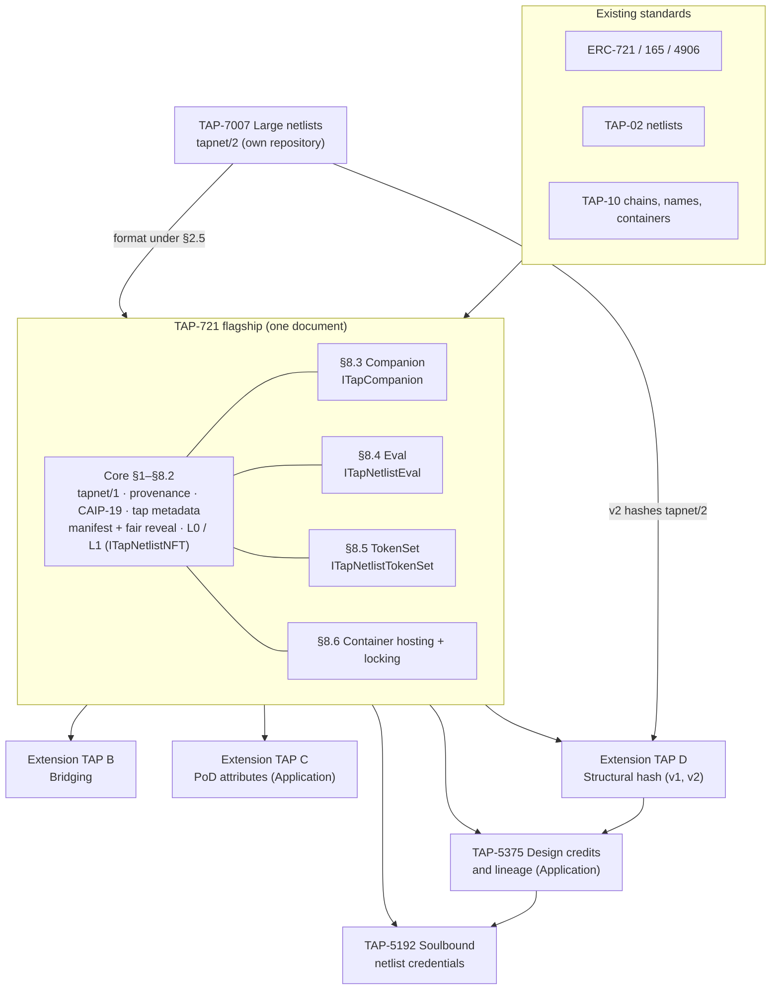
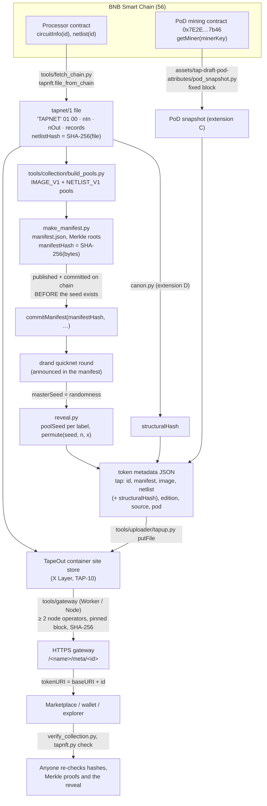
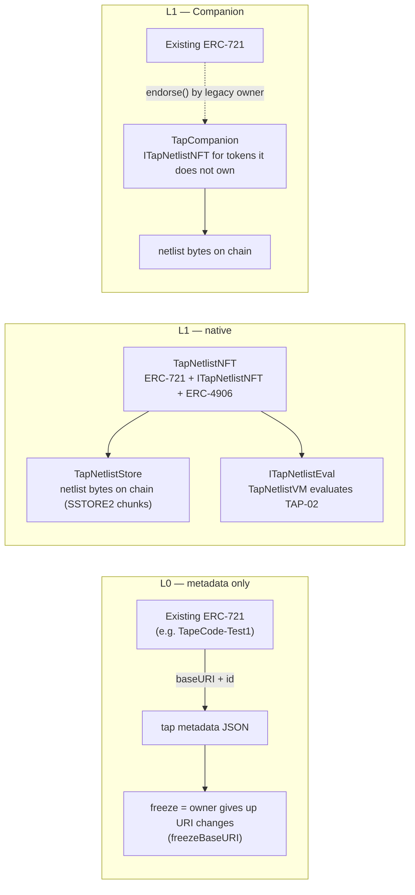

# Architecture

This page shows how the TAP-721 family and the reference code fit together. Normative details live in the
drafts under `TAPs/`; the shared working conventions are in [DESIGN.md](DESIGN.md). Section numbers below refer
to the flagship standard (TAP-721, `TAPs/TAP-draft-netlist-bound-nft.md`) unless marked otherwise.

## 0. The TAP-721 family



Like ERC-721 (which carries its metadata and enumeration extensions) with ERC-4906 and ERC-7496 as separate
ERCs: in-document extensions use the core's hashes, manifest and interface directly; extension TAPs have outside
dependencies (a message layer and upgradeable contracts for B, the BSC mining contract for C) or an audience
beyond NFTs (D), so they advance separately and cannot hold the flagship back.

Three related drafts were submitted on 2026-10-21, each with its own Idea issue and requested number:
TAP-7007 Large Netlists and Verifiable Execution (`tapnet/2` with ROM and RAM, chunked netlist hash, one-step
verifiers, dispute rules; #71 / PR #74; specification and reference implementation in
[tap-large-netlists](https://github.com/BruceLanLan/tap-large-netlists)), TAP-5375 Design Credits and Lineage
(`TAPs/TAP-draft-design-credits.md`; #72 / PR #75) and TAP-5192 Soulbound Netlist Credentials
(`TAPs/TAP-draft-soulbound-credentials.md`; #73 / PR #76). TAP-7007 does not require TAP-721: the flagship's §2.5
lets it register `tapnet/2`, and version 2 of extension D hashes `tapnet/2` files.

## 1. End-to-end data flow

From a mining circuit on BNB Smart Chain to a token page on a marketplace:



Key properties:

- **Commit before randomness.** The manifest fixes every pool entry by Merkle root and names the drand round.
  It must be on chain (container file plus commit block time) before that round is produced (§5.1, §6.1).
- **One seed, independent pools.** `poolSeed = SHA-256(masterSeed ‖ u64be(chainId) ‖ address ‖ label)`; each
  pool is assigned by its own keyed Feistel permutation with cycle walking (§6, DESIGN.md §4).
- **Content addressing everywhere.** Images, netlists and the manifest are identified by SHA-256; URIs are
  hints. The gateway is untrusted: clients re-hash what they fetch.
- **Containers are not permanent by default.** Activation expires (`paidUntil`); `TapContainerLock`
  (`contracts/src/tools/`) freezes writes while letting anyone renew. Metadata containers must not set an
  SPA fallback, or a missing `meta/<id>` returns HTTP 200 (see [FACTS.md](FACTS.md)).

## 2. Conformance levels: L0, L1 and Companion



- **L0**: JSON rules, manifest and off-chain reveal. Tools label it "metadata only"; frozenness is read from
  the chain, never from metadata (§7, §8.1).
- **L1**: the contract (or a Companion bound to an existing ERC-721) implements `ITapNetlistNFT`, ERC-165 and
  ERC-4906, and serves netlist bytes to other contracts (§8.2). `bind` checks Merkle proofs against the
  committed roots; alternatively `loadPool` / `loadPoolChunk` load a whole pool at once and rebuild its root on
  chain, replacing per-token `bind` transactions; `storeNetlist` accepts only bytes whose SHA-256 a token holds, so storage is
  permissionless and idempotent.
- **Companion** (§8.3): gives an existing collection (TapeCode-Test1 has no per-token setter and no ERC-4906)
  an L1 surface without migrating tokens. `frozen()` latches once true.

## 3. Bridging (extension TAP B)

```mermaid
sequenceDiagram
  autonumber
  participant U as Holder
  participant GW as TapGateway (home chain)
  participant AD as Adapter(s)<br/>LayerZero V2 / TAP-10 hub relay
  participant MI as TapMirror (remote chain)
  U->>GW: bridge(tokenId, dstChainId, to, contractRecipientOk, options)
  GW->>GW: escrow token (transferFrom), nonce++
  GW->>AD: payload v1 (320 bytes, abi.encode)<br/>collectionKey, tokenId, to, hashes, src, dst, nonce
  AD->>MI: receivePayload(srcChain, srcEndpoint, payload)
  Note over MI: checks route, adapter, peer, chain ids,<br/>collectionKey, replay (messageId = keccak256(srcEndpoint ‖ payload));<br/>ALL policy waits for every listed adapter
  MI->>U: mint tokenId with the same netlist/image/manifest hashes
  U->>MI: materialize(tapnet) — anyone, if sha256 matches
  U->>MI: bridge back → burn, payload to GW → release from escrow
```

- **Invariant:** for each token id, at most one non-escrowed live token across all chains.
- **Hub and spoke:** tokens move home → mirror and mirror → home only; a mirror-to-mirror move is two transfers
  through the home chain. The gateway records `locationOf[id]` and releases a token only on a message from the
  chain it departed to, so a compromised route can only affect tokens on its own chain.
- **Route policy** per (src, dst): `ONE` (exactly one adapter, default) or `ALL` (every listed adapter must
  deliver the identical payload). `ANY` is not offered.
- **Sealing:** each adapter is sealed first (`seal()` clears its owner and, for LayerZero, the delegate, and
  requires pinned send/receive libraries); `sealRoutes()` then freezes routes and requires every listed adapter
  to report `adapterSealed()`. See [SECURITY.md](SECURITY.md).
- **Message ids** are `keccak256(srcEndpoint ‖ payload)`, so a redeployed endpoint cannot collide with an old one.
- **TAP-10 hub profile** is **[Open]**: the hub stores messages only on the sender's chain, so the reference
  adapter accepts relayed payloads with K-of-N EIP-712 attestations from a fixed attester set.
- **Test coverage:** the bridge contracts are tested with mock endpoints and adapters and with the shared
  payload vectors only; nothing has been run over real LayerZero V2 or hub messages, and nothing is deployed.
- The official TapeOut rig bridge (BSC vault → X Layer voucher over LayerZero V2) is an existing, separate
  system; addresses in [FACTS.md](FACTS.md).

## 4. Code map

| Component | Family part | Reference code | Tests |
|---|---|---|---|
| `tapnet/1`, manifest, Merkle, permutation, metadata | Core | `assets/tap-draft-netlist-bound-nft/tapnft.py`, `tap02_reference.py` | `test_tapnft.py`, `contracts/test/core/CoreVectors.t.sol` |
| L1 collection and Companion | Core §8.2, §8.3 | `contracts/src/core/` | `contracts/test/core/`, `contracts/test/audit/AuditCore.t.sol` |
| Netlist VM (TAP-02 evaluation) | Eval extension §8.4 | `contracts/src/core/TapNetlistVM.sol` | `TapNetlistEval.t.sol`, `AuditVM.t.sol` (differential fuzz) |
| Gateway, Mirror, adapters | Extension B | `contracts/src/bridge/`, `assets/tap-draft-netlist-nft-bridging/make_vectors.py` | `contracts/test/bridge/`, `AuditBridge.t.sol` |
| PoD attributes, functional check | Extension C | `assets/tap-draft-pod-attributes/` (`function_check.py`), `tools/collection/verify_function.py` | `test_pod.py` |
| Eager pool loading | Core §8.2 item 3 | `TapNetlistCore.loadPool` | `contracts/test/core/TapPoolLoad.t.sol`, `CoreGas.t.sol` |
| Structural hash | Extension D | `assets/tap-draft-netlist-structural-hash/canon.py` (v1), `canon2.py` (v2, `tapnet/2`) | `test_canon.py`, `test_canon2.py` |
| Design credits and lineage | TAP-5375 | `assets/tap-draft-design-credits/credits.py` | `test_credits.py` |
| Soulbound credentials | TAP-5192 | `assets/tap-draft-soulbound-credentials/soulbound.py`, `contracts/src/` there (separate Foundry project) | `test_soulbound.py`, `contracts/test/` there (forge) |
| Mint-bound collections (core §8.2, 2026-10-21 revision) | Core | `contracts/src/core/TapMintBoundNFT.sol` (L1 without a manifest: hashes recorded at mint, `storeNetlist` from `TapNetlistStore` with the on-chain check) | `contracts/test/core/TapMintBoundNFT.t.sol` (unit, gas, differential against `vectors.json`) |
| Collection pipeline | profile | `tools/collection/` | `test_pipeline.py` (network) |
| Container upload, lock | profile | `tools/uploader/`, `contracts/src/tools/TapContainerLock.sol` | `test_e2e.py`, `test/fork/ContainerLock.t.sol` (fork) |
| Server-side gateway | profile / TAP-10 | `tools/gateway/` | `test/unit.test.mjs`, `test/live.test.mjs` (network) |
