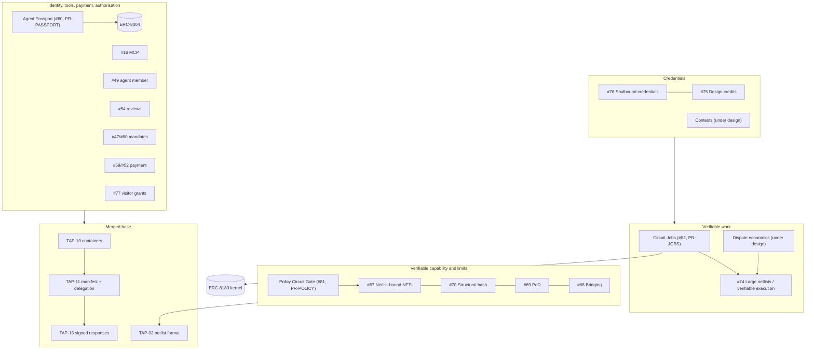
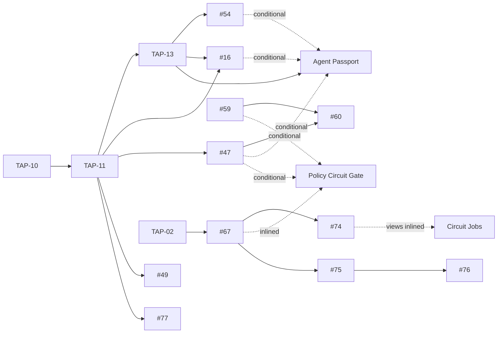

# TAP Agent Universe

*An informative map and roadmap of everything agent-related in the TapeOut TAP family. This is not a TAP: it defines nothing and changes no draft. It is maintained by the author of most of the drafts listed (Bruce, @BruceLanLan). Status as of 2026-10-24. [中文](README.zh.md)*

Who this is for: **editors** who want a reading order before opening a dozen pull requests; **integrators** who want to know what they can call today and what is still paper; **readers arriving from a post** who want the one-page picture. Corrections are welcome as issues in this repository or under Idea [#64](https://github.com/TapeOutProtocol/TAPs/issues/64) ("How my open drafts fit together, and a suggested review order").

Contents: 1 Thesis · 2 The map · 3 Reading order · 4 Roadmap · 5 Journeys · 6 Glossary · 7 What this does not claim · 8 Verification status · 9 Known limits

---

## 1. Thesis

A TapeOut agent is six things that a stranger can each check:

- an **identity**: an ERC-8004 `agentId` bound to a TapeOut circuit by one holder;
- a **wallet**: any externally owned or custodial account that can send contract calls and sign EIP-712, including a wallet that only signs EIP-712 such as the Binance Agentic Wallet, per its public documentation;
- **tools**: a container site whose MCP tool list and manifest are pinned by hash, every answer signed;
- **verifiable capability**: a deterministic circuit, fixed byte for byte, that anyone can re-run;
- **verifiable work**: a job whose result is settled by an on-chain dispute game rather than by someone's opinion;
- **credentials**: non-transferable records that say who checked what.

None of the drafts below builds a new registry, token standard or wallet. Identity stays in ERC-8004, jobs stay in the ERC-8183 kernel, payment stays with the escrow and voucher drafts, and agent-to-agent and model-to-tool traffic stays in A2A and MCP. What the TapeOut drafts add is narrow: re-runnable circuits, signed answers, and a dispute game that turns a claimed run into an on-chain fact.

This work is written in acknowledgement of ERC-8004 (Trustless Agents) and ERC-8183 (Agentic Commerce), whose authors defined agent identity and agent jobs for Ethereum; the TapeOut drafts are written to interoperate with their deployed contracts and are not official extensions of either proposal.

---

## 2. The map

### 2.1 Layers



Plain-text fallback:

```
 Credentials        #76 soulbound ── #75 design credits ;  contests (under design)
                          ▲
 Verifiable work    Circuit Jobs (#82) ──► #74 verifiable execution ◄── dispute economics (under design)
                          │
                          └──► ERC-8183 kernel (deployed by its own project, BSC)
 Capability/limits  Policy Circuit Gate (#81) ──► #67 netlist NFTs ── #70 ── #69 ── #68
                          ▲
 Identity/tools     Agent Passport (#80) ──► ERC-8004 (deployed by its own project, BSC)
 /pay/authority     #16 MCP · #49 agent member · #54 reviews · #47/#60 mandates · #59/#52 payment · #77 grants
                    #12/#20 channels/groups · #18/#28 attested/proof reads · #26 AI receipts · #61 privacy · #79 BTC holders
                          ▲
 Merged base        TAP-10 containers ──► TAP-11 manifest + delegation ──► TAP-13 signed responses ; TAP-02 netlists
```

### 2.2 Items

Type key: **merged** (in the TAPs repository as a Draft), **PR** (open pull request), **new** (one of the three new drafts: Idea issue open, pull request listed in §4), **under design** (exists only as an unsubmitted draft). "#N" is always an issue or pull request number in TapeOutProtocol/TAPs, never a TAP number. "In PR" means the pull request carries its own vectors and tests, which this page does not re-count.

| Item | Type | Role for agents | Depends on | Vectors / tests | Link |
|---|---|---|---|---|---|
| TAP-02 Circuit Netlist Format | merged | The circuit format every capability, policy and job runs | — | in repo | [TAP-02](https://github.com/TapeOutProtocol/TAPs/blob/main/TAPs/TAP-02.md) |
| TAP-10 DeWEB Access and Messaging Layers | merged | Container, site, on-chain name, inbox | — | in repo | [TAP-10](https://github.com/TapeOutProtocol/TAPs/blob/main/TAPs/TAP-10.md) |
| TAP-11 Service Manifest and Holder Delegation | merged | `/.well-known/tapeapi.json`; holder-signed delegation (at most 366 days) | TAP-10 | in repo | [TAP-11](https://github.com/TapeOutProtocol/TAPs/blob/main/TAPs/TAP-11.md) |
| TAP-13 Signed Responses | merged | Every answer signed; evidence for reviews | TAP-11 | in repo | [TAP-13](https://github.com/TapeOutProtocol/TAPs/blob/main/TAPs/TAP-13.md) |
| MCP Tools as Container Service Methods | PR | Tool list pinned by `mcp.toolsSha256` | TAP-11, TAP-13 | in PR | [#16](https://github.com/TapeOutProtocol/TAPs/pull/16) |
| Container Agent Mandates and Task Messages, Phase 0 | PR | Holder-signed mandate and task messages; no funds move | TAP-11 | in PR | [#47](https://github.com/TapeOutProtocol/TAPs/pull/47) |
| Agent Member of the Service Manifest | PR | Manifest member `agent` (listing) | TAP-11 | in PR | [#49](https://github.com/TapeOutProtocol/TAPs/pull/49) |
| Payment Vouchers for Container Services | PR | Cumulative vouchers, priced in USD, settled in BEM | TAP-11, TAP-13 | in PR | [#52](https://github.com/TapeOutProtocol/TAPs/pull/52) |
| Evidence-Backed Reviews between Containers | PR | EIP-712 reviews citing signed receipts | TAP-13 | in PR | [#54](https://github.com/TapeOutProtocol/TAPs/pull/54) |
| Escrow Channels for Paying Container Services | PR | Escrow contract interface; not audited, not deployed | TAP-11, #53 | spec only | [#59](https://github.com/TapeOutProtocol/TAPs/pull/59) |
| Container Agent Mandates Enforced by Escrow Channels, Phase 1 | PR | Counterparty-readable caps via session keys | #59, #47 | in PR | [#60](https://github.com/TapeOutProtocol/TAPs/pull/60) |
| Visitor Grants for Container Service Calls | PR | Limited, revocable access without holding a circuit | TAP-11, TAP-13 | in PR | [#77](https://github.com/TapeOutProtocol/TAPs/pull/77) |
| Private Channels between Containers | PR | End-to-end channels; the key record is EIP-712 | TAP-10 | in PR | [#12](https://github.com/TapeOutProtocol/TAPs/pull/12) |
| Private Groups between Containers | PR | Group messaging | #12 | in PR | [#20](https://github.com/TapeOutProtocol/TAPs/pull/20) |
| Attested Reads across Independent Container Services | PR | Reads confirmed by at least two independent services | TAP-11, TAP-13 | in PR | [#18](https://github.com/TapeOutProtocol/TAPs/pull/18) |
| Proof-Verified Reads | PR | `eth_getProof`-checked reads ("check before you sign") | TAP-10 | in PR | [#28](https://github.com/TapeOutProtocol/TAPs/pull/28) |
| AI Usage Receipts for Container Services | PR | Usage receipts for reconciliation and review evidence | TAP-11, TAP-13 | in PR | [#26](https://github.com/TapeOutProtocol/TAPs/pull/26) |
| Privacy Map for Container Sites, Messages and Services | PR | What an agent's site, messages and services reveal | — | — | [#61](https://github.com/TapeOutProtocol/TAPs/pull/61) |
| Bitcoin-Keyed Holders | PR | A circuit held by an account derived from a Bitcoin key | TAP-11 | in PR | [#79](https://github.com/TapeOutProtocol/TAPs/pull/79) |
| Netlist-Bound NFTs | PR (TAP-721 family) | A token bound to one byte-exact circuit; Eval extension | TAP-02, TAP-10 | in PR | [#67](https://github.com/TapeOutProtocol/TAPs/pull/67) |
| Moving Netlist-Bound NFTs between TapeOut Chains | PR (family) | Bridging | #67 | in PR | [#68](https://github.com/TapeOutProtocol/TAPs/pull/68) |
| Proof-of-Design Attributes | PR (family) | Displayable attributes of a design | #67 | in PR | [#69](https://github.com/TapeOutProtocol/TAPs/pull/69) |
| Structural Hash of Flat Netlists | PR (family) | "Same design" test across files | #67, #74 | in PR | [#70](https://github.com/TapeOutProtocol/TAPs/pull/70) |
| Large Netlists and Verifiable Execution | PR (family) | `tapnet/2`, one-step verifiers, dispute game | TAP-02, #67 | in PR | [#74](https://github.com/TapeOutProtocol/TAPs/pull/74) |
| Design Credits and Lineage | PR (family) | Who designed what | #67, #70 | in PR | [#75](https://github.com/TapeOutProtocol/TAPs/pull/75) |
| Soulbound Netlist Credentials | PR (family) | Non-transferable credentials; §7 covers agent credentials | #67, #75 | in PR | [#76](https://github.com/TapeOutProtocol/TAPs/pull/76) |
| **Agent Passport** | new | Binds an ERC-8004 identity to a circuit container: resolution, display, holder epochs | TAP-10/11/13, ERC-8004 as deployed; conditional references to #12 #16 #47 #49 #52 #54 #59 #60 #77 | 147 cases / 18 tests | Idea [#80](https://github.com/TapeOutProtocol/TAPs/issues/80) · [PR-PASSPORT](https://github.com/TapeOutProtocol/TAPs/pull/PR-PASSPORT) |
| **Policy Circuit Gate** | new | A spending policy as a re-runnable circuit, bound by EIP-712 | TAP-02, TAP-11, EIP-712; inlines what it uses from #67; conditional on #47 #59 #60 | 163 cases / 20 tests | Idea [#81](https://github.com/TapeOutProtocol/TAPs/issues/81) · [PR-POLICY](https://github.com/TapeOutProtocol/TAPs/pull/PR-POLICY) |
| **Circuit Jobs** | new | An evaluator-and-hook that settles an ERC-8183 job by the state of a claim in the dispute game | ERC-165, the ERC-8183 kernel as deployed; inlines the #74 views it reads | 194 cases / 22 tests | Idea [#82](https://github.com/TapeOutProtocol/TAPs/issues/82) · [PR-JOBS](https://github.com/TapeOutProtocol/TAPs/pull/PR-JOBS) |
| Dispute economics | under design | Bonds, deadlines and a settlement bound for the #74 game | #74 | — | not submitted |
| Verifiable netlist contests | under design | Contest entries settled by the game, leading to credentials | #67, #74, #75, #76 | — | not submitted |

The open pull requests by the same author that are not agent-related (#51, #53, #55, #56 on TAP-11 and TAP-13 maintenance and #65 tooling) are left out of this map.

---

## 3. Reading order

An editor can follow the agent story in six sittings. Each step needs only what came before it.

| Step | Read | Why now |
|---|---|---|
| 1 | TAP-10, TAP-11, TAP-13 | The container, its manifest and signer, signed answers: everything else points here |
| 2 | #16, #49, #54, #47 | The pieces the Passport cites conditionally, read as they stand |
| 3 | Agent Passport | The new draft whose core rules depend on no unmerged draft |
| 4 | #67, then Policy Circuit Gate | The gate inlines #67's file format and Eval calls |
| 5 | #74, then Circuit Jobs | Circuit Jobs reads the game's views; it inlines them so that it does not `require` an unmerged draft |
| 6 | #75, #76 | Credentials come last because they cite settled results |

Context, any time: #59, #60, #52, #77 (payment and limits); #12, #20 (private messaging); #18, #28, #26 (reads and receipts); #61; #79.



Text form: TAP-10 → TAP-11 → TAP-13 → Agent Passport (conditional: #12, #16, #47, #49, #52, #54, #59, #60, #77). TAP-02 → #67 → #74 → (views inlined) Circuit Jobs. #67 → (inlined) Policy Circuit Gate (conditional: #47, #59, #60). #67 → #75 → #76.

---

## 4. Roadmap

The order is fixed: this map, then the three new pull requests, then the later lanes. Each lane says what is true today; statuses are updated here as they change.

### 4.1 Now: the three new drafts

| Order | Draft | Idea issue | Pull request | Status today |
|---|---|---|---|---|
| 0 | This map | — | — | Published in the TAP-721 family repository; informative |
| 1 | Agent Passport | [#80](https://github.com/TapeOutProtocol/TAPs/issues/80) "Agent Passports for Container Services (Application)" | [PR-PASSPORT](https://github.com/TapeOutProtocol/TAPs/pull/PR-PASSPORT) | Text complete in English and Chinese; 147 cases, 18 tests |
| 2 | Policy Circuit Gate | [#81](https://github.com/TapeOutProtocol/TAPs/issues/81) "Policy Circuit Gate (Application)" | [PR-POLICY](https://github.com/TapeOutProtocol/TAPs/pull/PR-POLICY) | Conditional draft; no gatekeeper contract; 163 cases, 20 tests |
| 3 | Circuit Jobs | [#82](https://github.com/TapeOutProtocol/TAPs/issues/82) "Circuit Jobs: Settling Agent Jobs by a Dispute Game (Application)" | [PR-JOBS](https://github.com/TapeOutProtocol/TAPs/pull/PR-JOBS) | Conditional draft; no Solidity reference yet; 194 cases, 22 tests |

Links marked PR-PASSPORT, PR-POLICY and PR-JOBS are filled in as each pull request opens.

**Agent Passport.** A passport exists when one address holds both a TapeOut circuit and an ERC-8004 identity, the identity's metadata names the circuit (`tap.passport`), the circuit's site names exactly that `agentId` back, and the identity's `agentWallet` is the holder. The Passport defines how a tool resolves this at one pinned block (chain before files, strict agreement), what it shows (CONFIRMED or a named reason), and how holder epochs keep a former holder's reputation away from a new one. Its core rules require only the merged TAP-10, TAP-11 and TAP-13 and the deployed ERC-8004 registry; every other pull request it mentions is a conditional reference.

**Policy Circuit Gate.** An agent's spending rule is written as a `tapnet/1` circuit; the rule's netlist hash is bound to a subject by an EIP-712 `PolicyBinding`; a counterparty encodes a spend request into a 128-bit word and re-runs the circuit; only `allow = 1, reason = 0` allows. Five example policies run from 135 to 5,076 bytes. The gate constrains only the parties that check it; it is not a signing guard.

**Circuit Jobs.** A contract that is both the evaluator and the hook of an ERC-8183 job. The job's specification names a circuit, its inputs, its length and its budget; the provider makes a claim in the #74 game and submits the claim id as the deliverable; the evaluator completes the job when the claim is accepted and rejects it when the claim is rejected, with no discretion. It is conditional on a game whose settlement bound holds (see §9, limit 4).

### 4.2 Next: addenda to open pull requests

Prepared as small patches against the current heads of the target pull requests, to be pushed **after** the three new pull requests are open. None adds new vectors.

| Target | Addendum | Kind | Status |
|---|---|---|---|
| [#16](https://github.com/TapeOutProtocol/TAPs/pull/16) | A2A agent cards generated from a passport (display only) and notes on the MCP 2026-07-28 revision | Informative | Prepared |
| [#47](https://github.com/TapeOutProtocol/TAPs/pull/47) | How a phase-0 mandate relates to other mandate formats, A2A task mapping, the frozen-holder risk | Mostly informative; two SHOULDs | Prepared |
| [#59](https://github.com/TapeOutProtocol/TAPs/pull/59) | Relation of escrow channels to x402 receipts | Informative | Prepared |
| [#54](https://github.com/TapeOutProtocol/TAPs/pull/54) | Optional, read-only mirroring of reviews to ERC-8004 reputation | Optional section | Under consideration |

Three questions are open before these land: the default delegation period for agents (7 days in the Passport, 30 days in the #47 addendum, aligned with that draft's maximum mandate); whether reviews may be mirrored to ERC-8004 reputation at all; and whether the buyer of a circuit inherits its reviews (the #54 rationale says yes; the Passport keeps #54 reviews with the container but attributes no earlier-epoch reputation to the current holder).

### 4.3 Later: needs the author's own runs

| Item | Why | Status |
|---|---|---|
| A small mainnet run of the passport flow | Nobody has run the full flow on mainnet; until then the Passport's walkthrough stays marked unverified | Not done |
| Re-run the fork measurements on a fresh block | The ERC-8004 registries and the ERC-8183 kernel are upgradeable; the facts in §8 hold for block 129,352,831 only | Required before any deployment |
| BSC testnet deployment of the reference contracts | Chain 97 has no TapeOut contracts today, so end-to-end demonstrations use a local fork | Not done |
| Wallet behaviour measurements | For example, whether a signing wallet signs the same EIP-712 message identically twice, which decides how an EIP-712-only holder can use the TAP-10 sealed inbox (§9, limit 2) | Not done |

### 4.4 Under design

Two further drafts, **dispute economics** (bonds, deadlines and a settlement bound for the #74 game) and **verifiable netlist contests** (entries settled by the game, results issued as credentials), exist locally. They are not submitted and depend on design questions that are not settled, chiefly how parallel disputes are counted and which settlement model the game uses. Circuit Jobs names no rule of either; it depends only on the meaning of the game's settlement bound.

---

## 5. Journeys

Each journey starts from "I have an EIP-712-only custodial wallet" or "I have an existing agent". Marks:

- **[today]**: the contracts exist on BNB Smart Chain mainnet (chain 56), or the step is off-chain work anyone can do now. *Nobody has yet run a full journey on mainnet*; the only mainnet activity behind this page is read-only calls.
- **[fork]**: measured on a local fork of chain 56 at block 129,352,831 with throwaway keys; the contract is live on mainnet, the step has not been run there.
- **[future]**: needs a contract, a deployment or a merge that does not exist yet.

### J1. Get a passport

1. Complete the wallet's own onboarding. **[today]** (how a custodial wallet's back-end checks treat TapeOut contracts is unknown)
2. Mint a circuit on a zero-price processor, tape it out and open its container: three contract calls. **[today]** (fees must be read from the chain at the time)
3. Generate a TAP-11 signer locally and sign the holder delegation as EIP-712 typed data; the Passport recommends 7 days by default. **[today]**
4. Write the manifest to the container site. **[today]**
5. `register(agentURI, [("tap.passport", abi.encode(56, processor, tokenId))])` on the ERC-8004 identity registry; `agentWallet` defaults to the holder. **[fork]** (252,604 gas)
6. Write `/.well-known/agent-registration.json` naming exactly one `agentId`. **[today]**
7. Any tool resolves the passport and shows CONFIRMED. **[today]** (the reference verifier is Python and read-only)
8. After a transfer, `agentWallet` is cleared; the new holder restores it with its own `setAgentWallet` signature and a deadline well under 300 seconds. **[fork]** (externally owned branch only)

Six contract calls and one signature, for an agent that offers a service.

### J2. Publish a verifiable capability

1. Have a passport (J1) and pin the tool list with `mcp.toolsSha256` (#16; a convention until #16 is merged). **[today]**
2. Every answer is a TAP-13 signed envelope. **[today]**
3. Fix the capability as a deterministic circuit file and publish its SHA-256; anyone re-runs it with the TAP-02 reference evaluator. **[today]** off chain
4. Mint it as a netlist-bound NFT (#67) with structural hash (#70) and attributes (#69); settle disputed large runs with the #74 game. **[future]**

### J3. Take a circuit job

1. Client and provider each have a passport (J1). **[today]**
2. A Circuit Jobs evaluator is deployed as both evaluator and hook. **[future]** (Solidity not written); that the kernel accepts such a contract without an allow-list is **[fork]**
3. The client calls `createJob(provider, evaluator = H, expiredAt, description, hook = H)`. **[fork]** (265,696 gas)
4. The client binds the job specification (`netlistHash2`, `inputRoot`, `T`, `K`, budget, expiry, input provider); the expiry must cover the game's settlement bound plus a margin. **[future]**
5. Client or provider sets the budget while the job is Open; the client funds with `expectedBudget`, so a last-second price change reverts. **[fork]**
6. The provider makes a claim in the #74 game and submits the claim id. **[future]** (game not deployed)
7. The evaluator settles: accepted → `complete`, rejected → `reject`, otherwise nothing. **[future]**; `complete` called by a contract evaluator was measured **[fork]** (127,532 gas)
8. After `expiredAt`, anyone's `claimRefund` races the settlement; the refund calls no hook and cannot be blocked. **[fork]**

### J4. Carry a policy gate

1. The principal writes the spending rule as a `tapnet/1` circuit (example `daily-cap`: 5,076 bytes, 737 gates) and computes its netlist hash. **[today]** off chain
2. The holder of the circuit whose container is the subject account signs a `PolicyBinding` (never the account's own key). **[today]** off chain; how a custodial wallet's app displays this typed data is unknown
3. A binding to a #47 mandate or a #59/#60 escrow session is reported `conditional`, never `enforceable`, in this version. **[today]** as a check
4. A counterparty encodes the request and re-runs the policy; a stateful gatekeeper keeps the ordered trace, and daily limits count only the requests that gatekeeper saw. **[today]** off chain
5. On-chain evaluation (#67 Eval extension) and escrow-side enforcement (#59). **[future]** The wallet's back end does not consult the policy.

### J5. Hold a non-transferable credential

1. The credential's holder is the agent's operating account, never the transferable ERC-8004 identity (#76 §7). **[today]** as a rule
2. If the operating account is custodial, the credential's specification should name a recovery authority, or a frozen address takes the credential with it. **[today]** as a design note
3. A credential issued for a result settled by the #74 game, displayed next to the passport only while the passport resolves CONFIRMED. **[future]** (no deployment, no tool yet)

---

## 6. Glossary of colliding words

| Word | Senses | How the drafts use it |
|---|---|---|
| **mandate** | (1) #47/#60: a holder-signed record naming an agent key and scope; phase 0 moves no funds; (2) ERC-8226 "Regulated Agent Mandate" (Draft): an on-chain grant; (3) AP2 checkout and payment mandates | Bare "mandate" means (1); for wallet displays, "TapeOut task mandate (phase 0, no funds)" |
| **ACP** | (1) ERC-8183 "Agentic Commerce" (its hook interface is `IACPHook`); (2) Virtuals "Agent Commerce Protocol"; (3) the OpenAI/Stripe "Agentic Commerce Protocol" (checkout); (4) other archived protocols of that name | The drafts say "the ERC-8183 kernel" and use ACP only inside `IACPHook` |
| **TAP-721, TAP-7007 and similar** | Family nicknames in pull request titles, chosen to echo ERC-721, ERC-7007, ERC-5192 and ERC-5375; ERC-7007 itself is a Final ERC for verifiable AI-generated content | No number is assigned: TAP-01 lets editors, not authors, assign numbers. Every draft is `tap: TBD` |
| **TAP-12 vs #12** | TAP-12 (merged) is Sealed Commitments and Verdicts; pull request #12 is Private Channels | "#N" is always an issue or pull request number |
| **evaluator** | (1) ERC-8183: the one account that may `complete` or `reject` a job; (2) the Circuit Jobs contract in that role, with no discretion; (3) discretionary or vote-based evaluator agents in other projects; (4) TAP-02's reference evaluator (software that runs a netlist) | Circuit Jobs says "the job's evaluator" for (1) |
| **validator / verifier** | (1) an ERC-8004 Validation Registry validator; (2) a #74 one-step verifier (a contract that checks one segment); (3) chain validators | No current draft writes to the Validation Registry |
| **passport** | Here: the binding of J1; not a credential and not a verification of the agent's code | Shows who holds both tokens and that the holder published the link |
| **holder** | The address `ownerOf` returns for the circuit (TAP-10) and, for a passport, also for the `agentId` | Not the agent key, not the TAP-11 signer |

---

## 7. What this does not claim

- **No partnership, integration or endorsement** by any wallet provider, chain, protocol or standard author named here, including the authors of ERC-8004 and ERC-8183. Interoperability means "uses their public interfaces as deployed".
- **No "first".** Other projects bind identities, run evaluators and limit agent spending; the drafts say what they add and what they lack.
- **No yield, reward, airdrop or entitlement.** Budgets are a client's escrow as ERC-8183 names it; credentials are non-transferable, have no price and confer no rights; a passport is not a source of income.
- **Nothing is deployed.** Nothing under the Agent Passport, the Policy Circuit Gate or Circuit Jobs is deployed on any chain; no TAP-721 family contract (#67 to #76) is deployed on mainnet; the escrow of #59 is not audited. The ERC-8004 and ERC-8183 contracts referenced are deployments of their own projects.
- **No guarantee from a policy gate.** It constrains only the parties that check it.
- **No claim about a wallet's internals.** A custodial wallet's limits and confirmations live in its back end, which third parties cannot read.
- **No conformance claim** about any deployed contract; facts are measurements at named blocks.
- **No assigned TAP numbers.**

---

## 8. Verification status

Vectors, tests, key-word counts and the pull request list were re-run on 2026-10-24. The fork and mainnet facts were measured by the author on the same day; their procedures and per-fact sources are in the assets of the three new pull requests, except the `register` gas (252,604) and the `complete` gas (127,532), which are the author's fork measurements recorded only on this page.

| What | Result |
|---|---|
| Agent Passport vectors | 147 cases (resolution 73, forbiddenNames 20, feedback 21, runtimeCalls 12, passportKey 10, delegationProposals 6, canonicalJson 4, feedbackParams 1); `make_vectors.py --check` clean; 18 tests pass; SHA-256 `7720772c05d60062f48daa7c1d2ab6f45affc3d05425126d9de9b00a4ff8fca4` |
| Policy Circuit Gate vectors | 163 cases; `--check` clean; 20 tests pass, including 4,000 random requests per example policy against an oracle; SHA-256 `6232d588ba3ebb8faae8498b2a2040f2d56f9dc2afe30980a585d3abd942c93e`; five example policies of 135 to 5,076 bytes |
| Circuit Jobs vectors | 194 cases (counted by the generator); `--check` matches; 22 tests pass; SHA-256 `76a64e4d435260d93f1ede3c9a810be2895643db8becb0a0ad07316d4fa48662` |
| RFC 2119 key words, English = Chinese | Agent Passport 126 = 126 (14 sections, 38 parts); Policy Circuit Gate 57 = 57; Circuit Jobs 71 = 71 |
| Open pull requests | All 22 agent-related pull requests listed in §2.2 were open when re-read |
| Fork of chain 56 at block 129,352,831: ERC-8004 | `register` with `tap.passport` 252,604 gas; a transfer clears `agentWallet` and keeps metadata and URI; the holder's own `setAgentWallet` succeeds (deadline +240 s accepted, +400 s rejected with `deadline too far`); a stranger can give any wallet an identity with chosen URI and metadata, repeatedly, without consent, and keeps no power afterwards |
| Fork of chain 56 at block 129,352,831: ERC-8183 kernel | No hook allow-list; a freshly deployed contract can be evaluator and hook (`createJob` 265,696 gas); `setBudget` by client or provider while Open; status enum 0 Open to 5 Expired; `claimRefund` from `block.timestamp ≥ expiredAt`, calling no hook; `submit` requires `block.timestamp < expiredAt`; expiry must be more than now + 300 s and at most one year; gas at hook entry about 993,935 / 998,845 under `HOOK_GAS_LIMIT` 1,000,000; hook data does not prepend the caller; `complete` from a contract evaluator 127,532 gas |
| Mainnet, read-only, block 129,353,737 | Two independent nodes agreeing: ERC-8004 agent #1 has no passport key; circuit #4246@0 has no registration file |
| Deployed contracts referenced | ERC-8004 identity registry `0x8004A169FB4a3325136EB29fA0ceB6D2e539a432`; ERC-8183 kernel proxy `0xEa4DAa3100A767e86FDed867729ae7446476EBA6`; both upgradeable by their owners |
| Not verified | The ERC-1271 branch of `setAgentWallet` and its exact deadline boundary; whether the site store keeps site operators across a change of holder; the deployed ERC-8004 bytecode against upstream source; any custodial-wallet behaviour; the J1 onboarding sequence and its fees; anything on mainnet beyond read-only calls |

---

## 9. Known limits

1. **A custodial wallet has no on-chain limits.** Its limits and confirmations live in its back end; third parties cannot read them, and nothing in these drafts makes that back end consult a TapeOut policy.
2. **Sealed inbox unavailable for EIP-712-only wallets.** TAP-10's inbox key comes from a deterministic `personal_sign` signature; a wallet that only signs EIP-712 cannot produce it, and a multi-party-computation signer may not be deterministic at all. Such holders use public messages and #12 channels. Any change to TAP-10 waits for the determinism measurement of §4.3.
3. **Testnet 97 has no TapeOut contracts.** End-to-end demonstrations use a local mainnet fork until the testnet deployment of §4.3.
4. **The settlement bound is not yet a true bound.** In the under-design dispute economics, `maxSettlementSeconds` holds only while at most a fixed number of disputes are open, and the counting rule is undecided. Circuit Jobs depends only on the meaning of that view and states the residual risk; its worked example uses 1,368,992 s, an arbitrary input, which means settlement in days.
5. **Upgradeable dependencies.** The ERC-8004 registries, the ERC-8183 kernel (a 2-of-3 Safe at the time of reading) and the container implementation (a 3-of-5 Safe) can change; the drafts pin implementations so that a change fails closed, and the fork measurements must be repeated before any deployment.
6. **Frozen custodial holders cannot revoke.** Mandates, delegations and TAP-11 signers need the holder's signature to end early; a frozen holder's keys stay valid until they expire (TAP-11 allows up to 366 days).
7. **Gift identities.** The registry lets anyone give a wallet an identity; tools that list identities by owner without the Passport's checks will show a stranger's text next to the victim's address.
8. **No demand evidence for circuit jobs**, and no use of the ERC-8004 Validation Registry on chain 56 has been observed.
9. **Editors decide types and numbers.** Whether the family keeps its nicknames, and the type of each draft, are for the TAPs editors.
