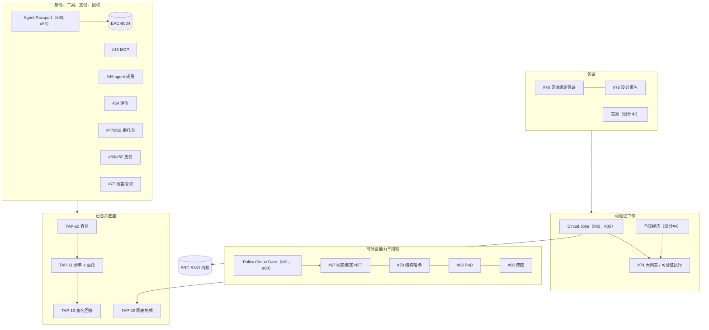
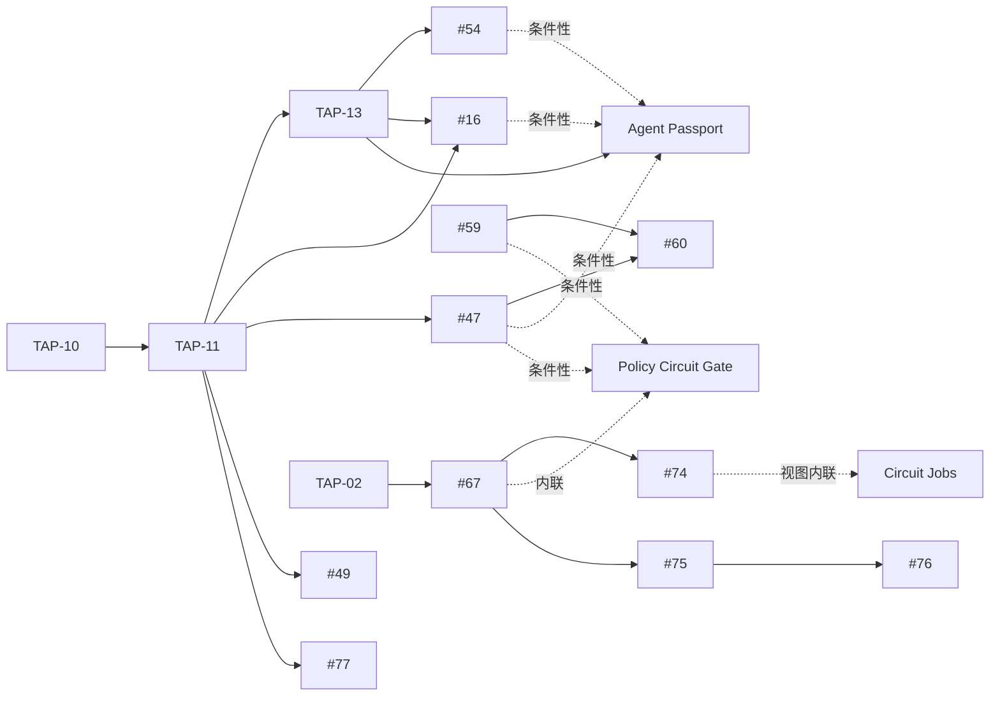

# TAP Agent Universe（TapeOut agent 全景图）

*TapeOut TAP 家族中所有与 agent 相关内容的信息性地图兼路线图。本文不是 TAP：不定义任何东西，也不修改任何草稿。维护者是下列大多数草稿的作者（Bruce，@BruceLanLan）。状态截至 2026-10-24。英文版为准，本文与之同步。[English](README.md)*

读者：**编辑**——在打开十几个 PR 之前先要一份阅读顺序；**集成方**——想知道今天能调用什么、什么还只是纸面；**从帖子过来的读者**——想要一页纸的全貌。欢迎在本仓库开 issue 指正，或在 Idea [#64](https://github.com/TapeOutProtocol/TAPs/issues/64)（"How my open drafts fit together, and a suggested review order"）下评论。

目录：1 核心主张 · 2 地图 · 3 阅读顺序 · 4 路线图 · 5 使用路径 · 6 易混词表 · 7 本文不声称什么 · 8 核验状态 · 9 已知限制

---

## 1. 核心主张

一个 TapeOut agent 由六样东西组成，每一样都能被陌生人核验：

- **身份**：一个 ERC-8004 `agentId`，由同一持有人绑定到一枚 TapeOut 电路；
- **钱包**：任何能发合约调用、能签 EIP-712 的外部账户或托管钱包，包括只签 EIP-712 的钱包，例如 Binance Agentic Wallet（据其公开文档）；
- **工具**：容器站点，MCP 工具列表与清单用哈希钉住，每次回答都签名；
- **可验证能力**：一份逐字节固定、任何人都能重跑的确定性电路；
- **可验证工作**：结果由链上争议博弈裁决、而不是由某人的意见决定的作业；
- **凭证**：不可转让的记录，写明谁核验了什么。

下列草稿都不新建注册表、代币标准或钱包。身份留在 ERC-8004，作业留在 ERC-8183 内核，支付留给托管与凭单草稿，agent 之间与模型到工具的通信留在 A2A 与 MCP。TapeOut 草稿补的部分很窄：可重跑的电路、签名回答，以及把"声称的运行结果"变成链上事实的争议博弈。

本工作致敬 ERC-8004（Trustless Agents）与 ERC-8183（Agentic Commerce），它们的作者为以太坊定义了 agent 身份与 agent 作业；TapeOut 草稿是为与其已部署合约互通而写，不是这两份提案的官方扩展。

---

## 2. 地图

### 2.1 分层



纯文本版：

```
 凭证          #76 灵魂绑定 ── #75 设计署名 ；竞赛（设计中）
                     ▲
 可验证工作    Circuit Jobs（#82）──► #74 可验证执行 ◄── 争议经济（设计中）
                     │
                     └──► ERC-8183 内核（由其项目自行部署，BSC）
 能力 / 限额   Policy Circuit Gate（#81）──► #67 网表 NFT ── #70 ── #69 ── #68
                     ▲
 身份 / 工具   Agent Passport（#80）──► ERC-8004（由其项目自行部署，BSC）
 / 支付 / 授权 #16 MCP · #49 agent 成员 · #54 评价 · #47/#60 委托书 · #59/#52 支付 · #77 访客授权
               #12/#20 通道/群组 · #18/#28 多方确认/带证明读取 · #26 AI 用量回执 · #61 隐私 · #79 BTC 持有人
                     ▲
 已合并底座    TAP-10 容器 ──► TAP-11 清单 + 委托 ──► TAP-13 签名回答 ；TAP-02 网表
```

### 2.2 条目

类型：**已合并**（以 Draft 状态在 TAPs 仓库中）、**PR**（open 的 pull request）、**新**（三份新草稿之一：Idea issue 已开，pull request 见 §4）、**设计中**（只有尚未提交的草稿）。"#N" 一律指 TapeOutProtocol/TAPs 中的 issue 或 pull request 编号，不是 TAP 编号。"见 PR"表示该 PR 自带向量与测试，本文不重新计数。

| 条目 | 类型 | 对 agent 的作用 | 依赖 | 向量 / 测试 | 链接 |
|---|---|---|---|---|---|
| TAP-02 Circuit Netlist Format | 已合并 | 所有能力、策略、作业运行的电路格式 | — | 见仓库 | [TAP-02](https://github.com/TapeOutProtocol/TAPs/blob/main/TAPs/TAP-02.md) |
| TAP-10 DeWEB Access and Messaging Layers | 已合并 | 容器、站点、链上名、收件箱 | — | 见仓库 | [TAP-10](https://github.com/TapeOutProtocol/TAPs/blob/main/TAPs/TAP-10.md) |
| TAP-11 Service Manifest and Holder Delegation | 已合并 | `/.well-known/tapeapi.json`；持有人签的委托（最长 366 天） | TAP-10 | 见仓库 | [TAP-11](https://github.com/TapeOutProtocol/TAPs/blob/main/TAPs/TAP-11.md) |
| TAP-13 Signed Responses | 已合并 | 每次回答都签名；评价的证据 | TAP-11 | 见仓库 | [TAP-13](https://github.com/TapeOutProtocol/TAPs/blob/main/TAPs/TAP-13.md) |
| MCP Tools as Container Service Methods | PR | 用 `mcp.toolsSha256` 钉住工具列表 | TAP-11、TAP-13 | 见 PR | [#16](https://github.com/TapeOutProtocol/TAPs/pull/16) |
| Container Agent Mandates and Task Messages, Phase 0 | PR | 持有人签的委托书与任务消息；不动资金 | TAP-11 | 见 PR | [#47](https://github.com/TapeOutProtocol/TAPs/pull/47) |
| Agent Member of the Service Manifest | PR | 清单成员 `agent`（登记） | TAP-11 | 见 PR | [#49](https://github.com/TapeOutProtocol/TAPs/pull/49) |
| Payment Vouchers for Container Services | PR | 累计凭单，美元定价、BEM 结算 | TAP-11、TAP-13 | 见 PR | [#52](https://github.com/TapeOutProtocol/TAPs/pull/52) |
| Evidence-Backed Reviews between Containers | PR | 引用签名回执的 EIP-712 评价 | TAP-13 | 见 PR | [#54](https://github.com/TapeOutProtocol/TAPs/pull/54) |
| Escrow Channels for Paying Container Services | PR | 托管合约接口；未审计、未部署 | TAP-11、#53 | 仅规范 | [#59](https://github.com/TapeOutProtocol/TAPs/pull/59) |
| Container Agent Mandates Enforced by Escrow Channels, Phase 1 | PR | 用会话密钥实现对方可读的上限 | #59、#47 | 见 PR | [#60](https://github.com/TapeOutProtocol/TAPs/pull/60) |
| Visitor Grants for Container Service Calls | PR | 不持有电路也能获得有限、可撤销的访问 | TAP-11、TAP-13 | 见 PR | [#77](https://github.com/TapeOutProtocol/TAPs/pull/77) |
| Private Channels between Containers | PR | 端到端通道；键记录用 EIP-712 | TAP-10 | 见 PR | [#12](https://github.com/TapeOutProtocol/TAPs/pull/12) |
| Private Groups between Containers | PR | 群组消息 | #12 | 见 PR | [#20](https://github.com/TapeOutProtocol/TAPs/pull/20) |
| Attested Reads across Independent Container Services | PR | 由至少两个独立服务确认的读取 | TAP-11、TAP-13 | 见 PR | [#18](https://github.com/TapeOutProtocol/TAPs/pull/18) |
| Proof-Verified Reads | PR | 用 `eth_getProof` 校验的读取（"签名前核对"） | TAP-10 | 见 PR | [#28](https://github.com/TapeOutProtocol/TAPs/pull/28) |
| AI Usage Receipts for Container Services | PR | 用量回执，用于对账与评价证据 | TAP-11、TAP-13 | 见 PR | [#26](https://github.com/TapeOutProtocol/TAPs/pull/26) |
| Privacy Map for Container Sites, Messages and Services | PR | agent 的站点、消息、服务会暴露什么 | — | — | [#61](https://github.com/TapeOutProtocol/TAPs/pull/61) |
| Bitcoin-Keyed Holders | PR | 由比特币密钥派生的账户持有电路 | TAP-11 | 见 PR | [#79](https://github.com/TapeOutProtocol/TAPs/pull/79) |
| Netlist-Bound NFTs | PR（TAP-721 家族） | 一枚代币绑定一份逐字节固定的电路；Eval 扩展 | TAP-02、TAP-10 | 见 PR | [#67](https://github.com/TapeOutProtocol/TAPs/pull/67) |
| Moving Netlist-Bound NFTs between TapeOut Chains | PR（家族） | 跨链 | #67 | 见 PR | [#68](https://github.com/TapeOutProtocol/TAPs/pull/68) |
| Proof-of-Design Attributes | PR（家族） | 设计的可展示属性 | #67 | 见 PR | [#69](https://github.com/TapeOutProtocol/TAPs/pull/69) |
| Structural Hash of Flat Netlists | PR（家族） | 跨文件判定"同一设计" | #67、#74 | 见 PR | [#70](https://github.com/TapeOutProtocol/TAPs/pull/70) |
| Large Netlists and Verifiable Execution | PR（家族） | `tapnet/2`、一步验证器、争议博弈 | TAP-02、#67 | 见 PR | [#74](https://github.com/TapeOutProtocol/TAPs/pull/74) |
| Design Credits and Lineage | PR（家族） | 谁设计了什么 | #67、#70 | 见 PR | [#75](https://github.com/TapeOutProtocol/TAPs/pull/75) |
| Soulbound Netlist Credentials | PR（家族） | 不可转让凭证；§7 涉及 agent 凭证 | #67、#75 | 见 PR | [#76](https://github.com/TapeOutProtocol/TAPs/pull/76) |
| **Agent Passport** | 新 | 把 ERC-8004 身份绑定到电路容器：解析、显示、持有人纪元 | TAP-10/11/13、已部署的 ERC-8004；条件性引用 #12 #16 #47 #49 #52 #54 #59 #60 #77 | 147 例 / 18 测试 | Idea [#80](https://github.com/TapeOutProtocol/TAPs/issues/80) · [#83](https://github.com/TapeOutProtocol/TAPs/pull/83) |
| **Policy Circuit Gate** | 新 | 支出策略即可重跑电路，用 EIP-712 绑定 | TAP-02、TAP-11、EIP-712；内联所用的 #67 部分；条件性引用 #47 #59 #60 | 163 例 / 20 测试 | Idea [#81](https://github.com/TapeOutProtocol/TAPs/issues/81) · [#84](https://github.com/TapeOutProtocol/TAPs/pull/84) |
| **Circuit Jobs** | 新 | 评估者兼钩子，按争议博弈中主张的状态结算 ERC-8183 作业 | ERC-165、已部署的 ERC-8183 内核；内联所读的 #74 视图 | 194 例 / 22 测试 | Idea [#82](https://github.com/TapeOutProtocol/TAPs/issues/82) · [#85](https://github.com/TapeOutProtocol/TAPs/pull/85) |
| 争议经济 | 设计中 | #74 博弈的保证金、期限与结算时限 | #74 | — | 未提交 |
| 可验证网表竞赛 | 设计中 | 参赛结果由博弈裁决，再发为凭证 | #67、#74、#75、#76 | — | 未提交 |

同一作者另有几个与 agent 无关的 open PR（#51、#53、#55、#56 是 TAP-11 与 TAP-13 的维护，#65 是工具），不列入本图。

---

## 3. 阅读顺序

编辑可以分六次读完 agent 这条线，每一步只需要前面读过的内容。

| 步 | 读 | 为什么在这一步 |
|---|---|---|
| 1 | TAP-10、TAP-11、TAP-13 | 容器、清单与签名者、签名回答：其余都指向这里 |
| 2 | #16、#49、#54、#47 | Passport 条件性引用的零件，按现状阅读 |
| 3 | Agent Passport | 核心规则不依赖任何未合并草稿的新草稿 |
| 4 | #67，然后 Policy Circuit Gate | 策略门内联了 #67 的文件格式和 Eval 调用 |
| 5 | #74，然后 Circuit Jobs | Circuit Jobs 读博弈的视图；它把视图内联，因而不 `requires` 未合并草稿 |
| 6 | #75、#76 | 凭证放最后，因为它引用已结算的结果 |

随时可读的背景：#59、#60、#52、#77（支付与限额）；#12、#20（私密通信）；#18、#28、#26（读取与回执）；#61；#79。



文字版：TAP-10 → TAP-11 → TAP-13 → Agent Passport（条件性：#12、#16、#47、#49、#52、#54、#59、#60、#77）。TAP-02 → #67 → #74 →（视图内联）Circuit Jobs。#67 →（内联）Policy Circuit Gate（条件性：#47、#59、#60）。#67 → #75 → #76。

---

## 4. 路线图

顺序是定的：本图，然后三个新 pull request，然后后续各条线。每条线写的是今天的实际状态；状态变化时在此更新。

### 4.1 现在：三份新草稿

| 顺序 | 草稿 | Idea issue | Pull request | 今天的状态 |
|---|---|---|---|---|
| 0 | 本图 | — | — | 发布在 TAP-721 家族仓库；信息性 |
| 1 | Agent Passport | [#80](https://github.com/TapeOutProtocol/TAPs/issues/80) "Agent Passports for Container Services (Application)" | [#83](https://github.com/TapeOutProtocol/TAPs/pull/83) | 中英文正文完整；147 例，18 个测试 |
| 2 | Policy Circuit Gate | [#81](https://github.com/TapeOutProtocol/TAPs/issues/81) "Policy Circuit Gate (Application)" | [#84](https://github.com/TapeOutProtocol/TAPs/pull/84) | 条件性草稿；没有守门合约；163 例，20 个测试 |
| 3 | Circuit Jobs | [#82](https://github.com/TapeOutProtocol/TAPs/issues/82) "Circuit Jobs: Settling Agent Jobs by a Dispute Game (Application)" | [#85](https://github.com/TapeOutProtocol/TAPs/pull/85) | 条件性草稿；尚无 Solidity 参考；194 例，22 个测试 |

三个 PR 都已开出：#83、#84、#85。

**Agent Passport。** 当同一地址同时持有一枚 TapeOut 电路和一个 ERC-8004 身份，身份的元数据指名该电路（`tap.passport`），电路站点反过来只指名这一个 `agentId`，且身份的 `agentWallet` 就是持有人时，护照成立。Passport 规定工具如何在一个钉住的区块上解析它（先链后文件、严格一致），显示什么（CONFIRMED 或一个具名原因），以及持有人纪元如何让前任持有人的声誉不落到新持有人身上。其核心规则只依赖已合并的 TAP-10、TAP-11、TAP-13 和已部署的 ERC-8004 注册表；它提到的其他 PR 都是条件性引用。

**Policy Circuit Gate。** agent 的支出规则写成一份 `tapnet/1` 电路；规则的网表哈希由 EIP-712 `PolicyBinding` 绑定到主体；对方把支出请求编码成一个 128 位字，重跑电路；只有 `allow = 1, reason = 0` 才放行。五个示例策略大小在 135 到 5,076 字节之间。策略门只约束去核查它的那一方，不是签名护栏。

**Circuit Jobs。** 一个同时充当 ERC-8183 作业评估者与钩子的合约。作业规格指明电路、输入、长度和预算；提供方在 #74 博弈中提出主张，并把主张 id 作为交付物提交；主张被接受时评估者完成作业，被驳回时拒绝作业，没有任何裁量。它以一个结算时限真正成立的博弈为前提（见 §9 第 4 条）。

### 4.2 下一步：对已有 PR 的追加补丁

已按目标 PR 当前头提交准备成小补丁，在三个新 PR 开出**之后**再推。都不新增向量。

| 目标 | 补丁 | 性质 | 状态 |
|---|---|---|---|
| [#16](https://github.com/TapeOutProtocol/TAPs/pull/16) | 由护照生成 A2A 名片（只用于显示），以及 MCP 2026-07-28 修订版说明 | 信息性 | 已备好 |
| [#47](https://github.com/TapeOutProtocol/TAPs/pull/47) | 阶段 0 委托书与其他委托格式的关系、A2A 任务映射、冻结持有人风险 | 大部分信息性；两个 SHOULD | 已备好 |
| [#59](https://github.com/TapeOutProtocol/TAPs/pull/59) | 托管通道与 x402 回执的关系 | 信息性 | 已备好 |
| [#54](https://github.com/TapeOutProtocol/TAPs/pull/54) | 可选、只读地把评价镜像到 ERC-8004 声誉 | 可选章节 | 考虑中 |

这些补丁落地前还有三个问题未定：agent 的默认委托期（Passport 是 7 天，#47 补丁是 30 天，与该草稿的最长委托期一致）；评价是否可以镜像到 ERC-8004 声誉；电路的买家是否继承其评价（#54 的理由部分说继承；Passport 让 #54 评价留在容器上，但不把较早纪元的声誉记到当前持有人名下）。

### 4.3 以后：需要作者本人实跑

| 项 | 原因 | 状态 |
|---|---|---|
| 主网小额实跑护照流程 | 还没有人在主网上把完整流程跑通；跑通前 Passport 的流程说明保持"未验证" | 未做 |
| 在新区块上重跑分叉实测 | ERC-8004 注册表和 ERC-8183 内核都可升级；§8 的事实只对块 129,352,831 成立 | 任何部署前必须做 |
| 把参考合约部署到 BSC 测试网 | 链 97 今天没有 TapeOut 合约，端到端演示只能用本地分叉 | 未做 |
| 钱包行为实测 | 例如签名钱包对同一条 EIP-712 消息两次签名是否相同，这决定只签 EIP-712 的持有人能否使用 TAP-10 密封收件箱（§9 第 2 条） | 未做 |

### 4.4 设计中

另有两份草稿，**争议经济**（#74 博弈的保证金、期限与结算时限）和**可验证网表竞赛**（参赛结果由博弈裁决，结果发为凭证），目前只在本地。它们尚未提交，依赖尚未定下的设计问题，主要是并行争议如何计数、博弈采用哪种结算模型。Circuit Jobs 不引用二者的任何规则，只依赖博弈结算时限这一视图的含义。

---

## 5. 使用路径

每条路径都从"我有一个只签 EIP-712 的托管钱包"或"我已有一个 agent"开始。标记：

- **[today]**：合约已在 BNB Smart Chain 主网（链 56）上，或这一步是任何人今天都能做的链下工作。*还没有人在主网上把任何一条路径完整跑通*；本文背后唯一的主网活动是只读调用。
- **[fork]**：在链 56 块 129,352,831 的本地分叉上用一次性密钥实测过；合约在主网上，但这一步没有在主网上跑过。
- **[future]**：需要尚不存在的合约、部署或合并。

### J1. 拿到护照

1. 完成钱包自己的开通流程。**[today]**（托管钱包后台检查如何对待 TapeOut 合约，未知）
2. 在零价格处理器上铸造电路、流片、打开容器：三次合约调用。**[today]**（费用须当时从链上读取）
3. 在本地生成 TAP-11 签名者，以 EIP-712 类型数据签持有人委托；Passport 默认建议 7 天。**[today]**
4. 把清单写入容器站点。**[today]**
5. 在 ERC-8004 身份注册表上调用 `register(agentURI, [("tap.passport", abi.encode(56, processor, tokenId))])`；`agentWallet` 默认为持有人。**[fork]**（252,604 gas）
6. 写 `/.well-known/agent-registration.json`，只指名一个 `agentId`。**[today]**
7. 任何工具解析护照并显示 CONFIRMED。**[today]**（参考验证器为 Python，只读）
8. 转移后 `agentWallet` 被清空；新持有人用自己的 `setAgentWallet` 签名恢复，截止时间远小于 300 秒。**[fork]**（只测了外部账户分支）

对一个提供服务的 agent：六次合约调用加一次签名。

### J2. 发布可验证能力

1. 持有护照（J1），并在清单里用 `mcp.toolsSha256` 钉住工具列表（#16；#16 合并前只是约定）。**[today]**
2. 每次回答都是 TAP-13 签名信封。**[today]**
3. 把能力固定为一份确定性电路文件并公布其 SHA-256；任何人都可用 TAP-02 参考评估器重跑。**[today]** 链下
4. 铸成网表绑定 NFT（#67），附结构哈希（#70）与属性（#69）；有争议的大规模运行由 #74 博弈裁决。**[future]**

### J3. 接一个电路作业

1. 委托方与提供方各有护照（J1）。**[today]**
2. 部署一个 Circuit Jobs 评估者，同时作为评估者与钩子。**[future]**（Solidity 未写）；内核无需允许列表即可接受这种合约是 **[fork]**
3. 委托方调用 `createJob(provider, evaluator = H, expiredAt, description, hook = H)`。**[fork]**（265,696 gas）
4. 委托方绑定作业规格（`netlistHash2`、`inputRoot`、`T`、`K`、预算、期限、输入提供方）；期限须覆盖博弈结算时限再加余量。**[future]**
5. 作业处于 Open 时委托方或提供方都可设预算；委托方用 `expectedBudget` 注资，最后一刻改价会回滚。**[fork]**
6. 提供方在 #74 博弈中提出主张，并提交主张 id。**[future]**（博弈未部署）
7. 评估者结算：接受 → `complete`，驳回 → `reject`，其他情况不动作。**[future]**；由合约评估者调用 `complete` 已实测 **[fork]**（127,532 gas）
8. `expiredAt` 之后，任何人的 `claimRefund` 与结算赛跑；退款不调用钩子，无法被阻止。**[fork]**

### J4. 携带策略门

1. 委托人把支出规则写成 `tapnet/1` 电路（示例 `daily-cap`：5,076 字节、737 门）并计算网表哈希。**[today]** 链下
2. 由"以主体账户为容器的那枚电路"的持有人签 `PolicyBinding`（绝不用该账户自己的密钥）。**[today]** 链下；托管钱包 App 如何显示这份类型数据，未知
3. 本版中，绑定到 #47 委托书或 #59/#60 托管会话的结果一律报告为 `conditional`，从不报告为 `enforceable`。**[today]** 作为检查
4. 对方编码请求并重跑策略；有状态的守门方保存有序轨迹，日限额只计该守门方见过的请求。**[today]** 链下
5. 链上求值（#67 Eval 扩展）与托管端强制（#59）。**[future]** 钱包后台不会查询策略。

### J5. 持有不可转让凭证

1. 凭证的持有者是 agent 的运营账户，绝不是可转让的 ERC-8004 身份（#76 §7）。**[today]** 作为规则
2. 若运营账户是托管的，凭证规范应指定恢复机构，否则地址被冻结时凭证随之失效。**[today]** 作为设计备注
3. 为 #74 博弈裁决的结果签发凭证，仅在护照解析为 CONFIRMED 时显示在护照旁边。**[future]**（无部署，尚无工具）

---

## 6. 易混词表

| 词 | 含义 | 草稿中的用法 |
|---|---|---|
| **mandate（委托书）** | (1) #47/#60：持有人签名的记录，指明 agent 密钥与范围；阶段 0 不动资金；(2) ERC-8226 "Regulated Agent Mandate"（Draft）：链上授权；(3) AP2 的 checkout 与 payment mandate | 单说"委托书"指 (1)；钱包显示用"TapeOut task mandate (phase 0, no funds)" |
| **ACP** | (1) ERC-8183 "Agentic Commerce"（其钩子接口为 `IACPHook`）；(2) Virtuals "Agent Commerce Protocol"；(3) OpenAI/Stripe "Agentic Commerce Protocol"（结账）；(4) 其他同名、已归档的协议 | 草稿说"ERC-8183 内核"，只在 `IACPHook` 中用 ACP |
| **TAP-721、TAP-7007 等** | PR 标题中的家族昵称，取自 ERC-721、ERC-7007、ERC-5192、ERC-5375 的呼应；ERC-7007 本身是一份关于可验证 AI 生成内容的 Final ERC | 没有分配编号：TAP-01 规定由编辑而不是作者分配编号。每份草稿都是 `tap: TBD` |
| **TAP-12 与 #12** | TAP-12（已合并）是 Sealed Commitments and Verdicts；PR #12 是 Private Channels | "#N" 一律是 issue 或 pull request 编号 |
| **evaluator（评估者）** | (1) ERC-8183：唯一可以 `complete` 或 `reject` 作业的账户；(2) 担任该角色、没有裁量的 Circuit Jobs 合约；(3) 其他项目中有裁量或投票制的评估 agent；(4) TAP-02 的参考评估器（运行网表的软件） | Circuit Jobs 对 (1) 说"作业的评估者" |
| **validator / verifier（验证者）** | (1) ERC-8004 Validation Registry 的验证者；(2) #74 的一步验证器（检查一个片段的合约）；(3) 链的验证节点 | 目前没有草稿写入 Validation Registry |
| **passport（护照）** | 此处指 J1 的绑定；不是凭证，也不是对 agent 代码的验证 | 表明谁同时持有两枚代币、且持有人公布了这一关联 |
| **holder（持有人）** | 电路的 `ownerOf` 返回的地址（TAP-10）；对护照而言也是 `agentId` 的持有人 | 不是 agent 密钥，也不是 TAP-11 签名者 |

---

## 7. 本文不声称什么

- **没有合作、集成或背书**：本文提到的任何钱包提供方、链、协议或标准作者，包括 ERC-8004 与 ERC-8183 的作者，都没有。互通的意思是"使用其已部署的公开接口"。
- **不称"首个"。** 其他项目也在绑定身份、运行评估者、限制 agent 支出；草稿写明自己补了什么、缺什么。
- **没有收益、奖励、空投或权益。** 预算是委托方按 ERC-8183 所称的托管；凭证不可转让、没有价格、不赋予任何权利；护照不是收入来源。
- **什么都没有部署。** Agent Passport、Policy Circuit Gate、Circuit Jobs 下的任何东西都没有部署在任何链上；TAP-721 家族（#67 至 #76）的合约没有部署到主网；#59 的托管合约未经审计。文中引用的 ERC-8004 与 ERC-8183 合约由其各自项目部署。
- **策略门不提供保证。** 它只约束去核查它的那一方。
- **不对任何钱包的内部做声明。** 托管钱包的限额与确认在其后台，第三方读不到。
- **不对任何已部署合约做一致性声明**；事实都是具名区块上的实测。
- **没有分配的 TAP 编号。**

---

## 8. 核验状态

向量、测试、关键词数与 PR 列表于 2026-10-24 重跑。分叉与主网事实由作者同日实测；每条事实的步骤与来源见三个新 PR 的资产目录，只有 `register` 的 gas（252,604）与 `complete` 的 gas（127,532）例外，它们是作者的分叉实测，只记录在本页。

| 项 | 结果 |
|---|---|
| Agent Passport 向量 | 147 例（resolution 73、forbiddenNames 20、feedback 21、runtimeCalls 12、passportKey 10、delegationProposals 6、canonicalJson 4、feedbackParams 1）；`make_vectors.py --check` 通过；18 个测试通过；SHA-256 `7720772c05d60062f48daa7c1d2ab6f45affc3d05425126d9de9b00a4ff8fca4` |
| Policy Circuit Gate 向量 | 163 例；`--check` 通过；20 个测试通过，其中每个示例策略对照预言机跑 4,000 个随机请求；SHA-256 `6232d588ba3ebb8faae8498b2a2040f2d56f9dc2afe30980a585d3abd942c93e`；五个示例策略 135 到 5,076 字节 |
| Circuit Jobs 向量 | 194 例（按生成器计数）；`--check` 一致；22 个测试通过；SHA-256 `76a64e4d435260d93f1ede3c9a810be2895643db8becb0a0ad07316d4fa48662` |
| RFC 2119 关键词，英文 = 中文 | Agent Passport 126 = 126（14 节、38 部分）；Policy Circuit Gate 57 = 57；Circuit Jobs 71 = 71 |
| open 的 pull request | §2.2 列出的 22 个 agent 相关 PR 重读时均为 open |
| 链 56 块 129,352,831 分叉：ERC-8004 | 带 `tap.passport` 的 `register` 252,604 gas；转移清空 `agentWallet`，保留元数据与 URI；持有人自己的 `setAgentWallet` 成功（截止 +240 秒通过，+400 秒以 `deadline too far` 拒绝）；陌生人可以把写好 URI 与元数据的身份反复送给任何钱包，无需对方同意，之后不保留任何权力 |
| 链 56 块 129,352,831 分叉：ERC-8183 内核 | 无钩子允许列表；新部署的合约可同时作评估者与钩子（`createJob` 265,696 gas）；Open 状态下委托方或提供方都可 `setBudget`；状态枚举 0 Open 至 5 Expired；`block.timestamp ≥ expiredAt` 起可 `claimRefund`，不调用钩子；`submit` 要求 `block.timestamp < expiredAt`；期限须大于当前 + 300 秒且不超过一年；在 `HOOK_GAS_LIMIT` 1,000,000 下钩子入口 gas 约 993,935 / 998,845；钩子数据不前置调用者；合约评估者调用 `complete` 127,532 gas |
| 主网只读，块 129,353,737 | 两个独立节点一致：ERC-8004 agent #1 没有护照键；电路 #4246@0 没有登记文件 |
| 引用的已部署合约 | ERC-8004 身份注册表 `0x8004A169FB4a3325136EB29fA0ceB6D2e539a432`；ERC-8183 内核代理 `0xEa4DAa3100A767e86FDed867729ae7446476EBA6`；二者都可由其所有者升级 |
| 未核验 | `setAgentWallet` 的 ERC-1271 分支及截止时间的确切边界；持有人变更后站点存储是否保留站点操作员；已部署 ERC-8004 字节码与上游源码是否一致；任何托管钱包的行为；J1 的开通步骤及费用；主网上除只读调用以外的一切 |

---

## 9. 已知限制

1. **托管钱包没有链上限额。** 其限额与确认在后台，第三方读不到，这些草稿也没有任何办法让后台去查询 TapeOut 策略。
2. **只签 EIP-712 的钱包用不了密封收件箱。** TAP-10 的收件箱密钥来自确定性的 `personal_sign` 签名；只签 EIP-712 的钱包产生不了它，多方计算签名者甚至可能根本不确定。这类持有人使用公开消息与 #12 通道。对 TAP-10 的任何修改都要等 §4.3 的确定性实测。
3. **测试网 97 没有 TapeOut 合约。** 在 §4.3 的测试网部署之前，端到端演示使用本地主网分叉。
4. **结算时限还不是真正的上限。** 在设计中的争议经济里，`maxSettlementSeconds` 只在同时开着的争议不超过固定数量时成立，计数规则未定。Circuit Jobs 只依赖该视图的含义，并写明剩余风险；其示例用的 1,368,992 秒是任意输入，意味着结算以天计。
5. **依赖可升级。** ERC-8004 注册表、ERC-8183 内核（读取时为 2-of-3 Safe）和容器实现（3-of-5 Safe）都可能变化；草稿钉住实现，变化时安全失败，任何部署前都必须重做分叉实测。
6. **被冻结的托管持有人无法撤销。** 委托书、委托和 TAP-11 签名者要提前结束都需要持有人签名；被冻结持有人的密钥在到期前一直有效（TAP-11 最长允许 366 天）。
7. **赠送身份。** 注册表允许任何人送给某个钱包一个身份；按所有者列出身份、却不做 Passport 检查的工具，会把陌生人的文字显示在受害者地址旁边。
8. **电路作业没有需求证据**，链 56 上也没有观察到 ERC-8004 Validation Registry 的使用。
9. **类型与编号由编辑决定。** 家族是否保留昵称、每份草稿属于哪种类型，由 TAPs 编辑决定。
